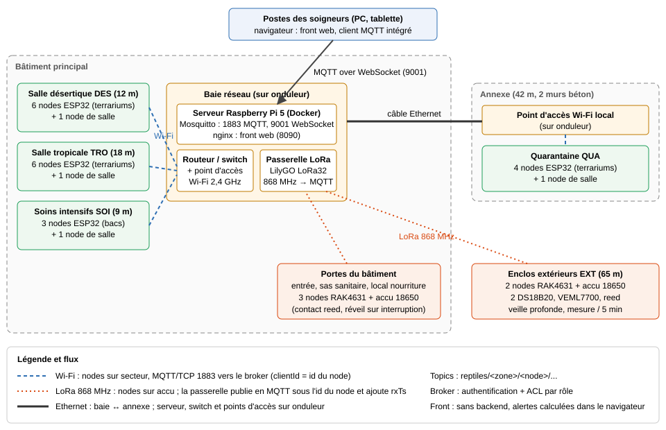

# Partie A : conception matérielle

Les matrices notent chaque critère de 1 (mauvais) à 5 (très bon). Le score est la somme des notes multipliées par les poids (total des poids = 100 %).

## A.1 Choix des composants

### Microcontrôleur des nodes secteur (enclos intérieurs et salles)

| Critère | Poids | ESP32-DevKitC (WROOM-32E) | ESP32-C3 SuperMini | Raspberry Pi Pico W | Arduino Nano 33 IoT |
|---|---|---|---|---|---|
| Coût | 25 % | 4 | 5 | 4 | 1 |
| Wi-Fi intégré, MQTT | 20 % | 5 | 5 | 4 | 4 |
| Bibliothèques (DS18B20, MQTT, OTA) | 20 % | 5 | 4 | 3 | 4 |
| Nombre de GPIO / interfaces | 15 % | 5 | 3 | 5 | 3 |
| Simulable sur Wokwi | 10 % | 5 | 4 | 4 | 2 |
| Consommation | 10 % | 3 | 4 | 3 | 4 |
| **Score** | | **4,55** | 4,3 | 3,85 | 2,9 |

**Choix : ESP32-DevKitC.** Wi-Fi intégré, énormément d'exemples (OneWire, MQTT, OTA), assez de broches pour les deux sondes, le capteur de lumière (I2C) et la porte, et il est directement disponible sur Wokwi. La consommation n'est pas un critère important ici : les nodes intérieurs sont sur secteur. L'ESP32-C3 est une bonne alternative si l'on veut gagner 5 € par node.

### Microcontrôleur + radio des nodes sur batterie (enclos extérieurs, portes du bâtiment)

| Critère | Poids | RAK4631 + base RAK19007 (nRF52840 + SX1262) | ESP32 + module RFM95W | Heltec CubeCell AB01 | Arduino MKR WAN 1310 |
|---|---|---|---|---|---|
| Courant en veille | 30 % | 5 (2 µA) | 2 (carte de dev : plusieurs mA, il faut une carte maison) | 5 (3,5 µA) | 3 (≈ 100 µA) |
| Radio longue portée intégrée | 20 % | 5 | 3 (module à câbler) | 5 | 5 |
| Disponibilité / pérennité | 20 % | 5 | 4 | 1 (fin de vie annoncée par Heltec) | 4 |
| Coût | 15 % | 3 | 4 | 4 | 1 |
| Gestion batterie / solaire intégrée | 15 % | 5 | 1 | 5 | 4 |
| **Score** | | **4,7** | 2,75 | 4,05 | 3,45 |

**Choix : RAK4631 sur base RAK19007.** Veille à 2 µA, radio LoRa SX1262 intégrée, connecteur batterie et entrée panneau solaire sur la base, alimentation commutable des capteurs (`3V3_S`) que l'on coupe pendant la veille. Le CubeCell aurait été un bon choix, mais Heltec l'a arrêté (puce ASR6502 en fin de vie).

### Sonde de température

| Critère | Poids | DS18B20 étanche (inox) | DHT22 | SHT31 en sonde étanche | PT100 + MAX31865 |
|---|---|---|---|---|---|
| Précision sur 5-55 °C | 30 % | 4 (±0,5 °C de -10 à 85 °C) | 4 (±0,5 °C) | 5 (±0,3 °C) | 5 |
| Étanchéité, tenue à l'humidité | 20 % | 5 | 2 | 4 | 4 |
| Coût | 20 % | 5 | 4 | 2 | 1 |
| Plusieurs sondes sur une broche | 15 % | 5 (bus 1-Wire) | 1 | 3 (I2C, 2 adresses) | 2 (SPI, 1 CS par sonde) |
| Simplicité de mise en œuvre | 15 % | 5 | 4 | 4 | 2 |
| **Score** | | **4,7** | 3,15 | 3,75 | 3,1 |

**Choix : DS18B20 en tube inox avec câble.** La précision demandée (±0,5 °C) est exactement celle du composant. Il est étanche, et les deux sondes (point chaud, point froid) partagent le même fil de données. Les valeurs spéciales du DS18B20 sont connues et filtrées par le front : `-127` (sonde débranchée) et `85` (valeur de mise sous tension).

### Capteur de lumière

| Critère | Poids | VEML7700 | BH1750 | TSL2591 | Photorésistance (LDR) |
|---|---|---|---|---|---|
| Plage (0 à 100 000 lx) | 35 % | 5 (0 à 120 000 lx) | 2 (max 65 535 lx) | 3 (max 88 000 lx) | 2 (non étalonnée) |
| Précision / sortie en lux | 25 % | 5 | 4 | 5 | 1 |
| Coût | 20 % | 4 | 5 | 3 | 5 |
| Consommation | 10 % | 5 | 4 | 4 | 3 |
| Bibliothèques | 10 % | 5 | 5 | 4 | 5 |
| **Score** | | **4,8** | 3,6 | 3,7 | 2,75 |

**Choix : VEML7700 (I2C).** C'est le seul des candidats qui couvre les 100 000 lx de l'énoncé : le BH1750 sature à 65 535 lx, et le soleil en extérieur dépasse les 85 000 lx. Sur Wokwi, qui ne propose pas de VEML7700, il est remplacé par le module photorésistance (voir A.3).

### Contact de porte

| Critère | Poids | Contact reed MC-38 + aimant | Capteur à effet Hall (A3144) | Micro-rupteur fin de course | Barrière infrarouge |
|---|---|---|---|---|---|
| Consommation | 30 % | 5 (passif) | 2 (≈ 4 mA en continu) | 5 | 1 |
| Fiabilité, pas d'usure | 25 % | 5 | 5 | 2 | 4 |
| Coût | 20 % | 5 | 5 | 5 | 2 |
| Pose sur une vitre de terrarium | 25 % | 5 | 4 | 2 | 2 |
| **Score** | | **5,0** | 3,85 | 3,5 | 2,2 |

**Choix : contact reed MC-38.** Il est passif (ne consomme rien, important sur pile) et se colle sur une porte vitrée coulissante. Il est câblé sur une broche avec pull-up et lu par **interruption** (front montant et descendant), avec un anti-rebond logiciel de 50 ms. Sur les nodes à pile, on utilise une résistance de pull-up de 1 MΩ (3,3 µA quand le contact est fermé) au lieu du pull-up interne (≈ 45 kΩ, soit 73 µA).

### Connectivité par zone

| Critère | Poids | Wi-Fi 2,4 GHz | LoRa 868 MHz (point à point) | Zigbee | Ethernet / PoE |
|---|---|---|---|---|---|
| Portée à travers les murs | 25 % | 2 | 5 | 3 | 5 (câble) |
| Consommation (nodes sur pile) | 20 % | 1 | 5 | 4 | 1 |
| Débit, latence (commandes, < 2 s) | 20 % | 5 | 3 (cycle de travail 1 %) | 4 | 5 |
| Coût d'infrastructure | 20 % | 5 (réseau existant) | 3 (passerelle) | 3 (coordinateur) | 1 (câblage, switch PoE) |
| Simplicité | 15 % | 5 | 3 | 3 | 3 |
| **Score** | | 3,45 | **3,9** | 3,4 | 3,1 |

Le meilleur choix dépend de la zone :

| Zone | Choix | Justification |
|---|---|---|
| DES (12 m, placo), TRO (18 m, placo), SOI (9 m) | **Wi-Fi** | nodes sur secteur, proches de la baie, cloisons légères : le Wi-Fi existant suffit (RSSI simulé entre -45 et -60 dBm). Débit et latence parfaits pour les commandes. |
| QUA (42 m, 2 murs béton 30 cm) | **Wi-Fi via un point d'accès dans l'annexe**, relié à la baie par un câble Ethernet | chaque mur de béton de 30 cm atténue d'environ 15 dB : depuis la baie, le signal serait inutilisable (le simulateur donne -85 dBm). Un point d'accès local garde des nodes identiques aux autres salles. |
| EXT (65 m, extérieur, sans courant) | **LoRa 868 MHz** vers une passerelle dans le bâtiment | seule technologie compatible avec 6 mois sur batterie et 65 m en extérieur. |
| Portes du bâtiment (sur pile) | **LoRa** (même passerelle) | sur pile, pas de câble à tirer. Une trame LoRa SF7 dure environ 60 ms : la porte reste visible en moins de 2 s. |

### Alimentation

| Critère | Poids | Bloc USB 5 V secteur | PoE (802.3af) | Li-ion 18650 3000 mAh | 3 piles AA alcalines |
|---|---|---|---|---|---|
| Disponibilité sur place | 30 % | 5 (prises déjà là pour les lampes) | 3 | 5 | 5 |
| Coût | 25 % | 5 | 2 | 4 | 4 |
| Autonomie / entretien | 25 % | 5 | 5 | 4 | 2 |
| Tenue au froid et à l'extérieur | 20 % | 2 | 3 | 4 | 2 |
| **Score** | | **4,4** | 3,25 | 4,3 | 3,4 |

**Choix : bloc USB 5 V pour les nodes intérieurs, accu 18650 pour les nodes sur pile** (EXT et portes du bâtiment). Le 18650 se branche sur la base RAK19007, qui accepte aussi un petit panneau solaire si l'on veut supprimer complètement les interventions. Pour SOI (température stable exigée) et QUA, on prévoit un onduleur sur la baie et le point d'accès : une coupure de courant ne doit pas couper la supervision.

## A.2 Nomenclature chiffrée (BOM)

Prix unitaires relevés le 11/10/2026 (TTC sauf mention). Les petites fournitures sont estimées.

### Node enclos intérieur (×19)

| Composant | Qté | Prix unitaire | Total | Source |
|---|---|---|---|---|
| ESP32-DevKitC-32E | 1 | 8,90 € HT | 8,90 € | SOS Electronic, réf. 351534 |
| Sonde DS18B20 étanche 1 m | 2 | 1,61 € | 3,22 € | AZ-Delivery, lot de 10 à 16,07 € (eBay.de) |
| Module VEML7700 | 1 | 4,60 € (4,95 $) | 4,60 € | Adafruit, réf. 4162 |
| Contact reed MC-38 | 1 | 2,50 € | 2,50 € | Tinytronics |
| Bloc secteur USB 5 V 1 A + câble | 1 | 4,00 € | 4,00 € | estimation (grande surface) |
| Boîtier ABS, bornier, résistance 4,7 kΩ, plaque à pastilles | 1 | 3,00 € | 3,00 € | estimation |
| **Total** | | | **26,22 €** | ≤ 30 € ✔ |

### Node de salle (ambiance + porte de salle, ×4)

| Composant | Qté | Total |
|---|---|---|
| ESP32-DevKitC-32E | 1 | 8,90 € |
| Sonde DS18B20 étanche | 1 | 1,61 € |
| Contact reed MC-38 | 1 | 2,50 € |
| Bloc USB 5 V + boîtier + connectique | 1 | 7,00 € |
| **Total** | | **20,01 €** |

### Node enclos extérieur (×2)

| Composant | Qté | Prix unitaire | Total | Source |
|---|---|---|---|---|
| RAK19007 + RAK4631 (lot) | 1 | 28,00 € (29,99 $) | 28,00 € | Ameridroid |
| Sonde DS18B20 étanche | 2 | 1,61 € | 3,22 € | AZ-Delivery |
| Module VEML7700 (sous dôme transparent) | 1 | 4,60 € | 4,60 € | Adafruit |
| Contact reed MC-38 | 1 | 2,50 € | 2,50 € | Tinytronics |
| Accu Li-ion 18650 3000 mAh | 1 | 6,00 € | 6,00 € | estimation |
| Boîtier étanche IP65 + presse-étoupes | 1 | 8,00 € | 8,00 € | estimation |
| Antenne 868 MHz | 1 | 5,00 € | 5,00 € | estimation |
| **Total** | | | **57,32 €** | (hors budget « enclos intérieur ») |

### Node porte de bâtiment (×3)

| Composant | Qté | Total |
|---|---|---|
| RAK19007 + RAK4631 | 1 | 28,00 € |
| Contact reed MC-38 | 1 | 2,50 € |
| Accu 18650 + boîtier | 1 | 10,00 € |
| **Total** | | **40,50 €** |

### Infrastructure

| Élément | Prix | Source |
|---|---|---|
| Serveur : Raspberry Pi 5 4 Go + alimentation + carte SD (Mosquitto, front, Docker) | 90 € | estimation |
| Passerelle LoRa → MQTT : LilyGO LoRa32 V2.1 868 MHz (ESP32 + SX1276) | 42 € | Open Electronics |
| Point d'accès Wi-Fi pour l'annexe QUA | 35 € | estimation |
| Câble Ethernet extérieur 50 m (baie → annexe) | 35 € | estimation |
| Onduleur (serveur, switch, point d'accès) | 70 € | estimation |
| **Total infrastructure** | **272 €** | |

### Total du site

| Poste | Quantité | Unitaire | Total |
|---|---|---|---|
| Node enclos intérieur | 19 | 26,22 € | 498,18 € |
| Node de salle | 4 | 20,01 € | 80,04 € |
| Node enclos extérieur | 2 | 57,32 € | 114,64 € |
| Node porte de bâtiment | 3 | 40,50 € | 121,50 € |
| Infrastructure | 1 | 272,00 € | 272,00 € |
| **Total** | | | **1 086,36 €** |

## A.3 Node enclos intérieur sur Wokwi

Fichiers : `wokwi/diagram.json`, `wokwi/sketch.ino`, `wokwi/libraries.txt`. Lien du projet : https://wokwi.com/projects/477594866988217345

Câblage :

| Élément | Broche ESP32 | Remarque |
|---|---|---|
| DS18B20 point chaud | GPIO 4 (1-Wire) | pull-up 4,7 kΩ vers 3,3 V |
| DS18B20 point froid | GPIO 5 (1-Wire) | sur Wokwi, un bus par sonde ; en vrai les deux sondes peuvent partager GPIO 4 |
| Capteur de lumière | GPIO 34 (ADC) | Wokwi n'a pas de VEML7700 : module photorésistance, converti en lux. Le vrai VEML7700 serait sur I2C (GPIO 21 SDA / 22 SCL). |
| Contact de porte | GPIO 27 | `INPUT_PULLUP`, interruption `CHANGE`, anti-rebond 50 ms. Simulé par un interrupteur à glissière. |

Fonctionnement du programme :

- toutes les 5 s (30 s en vrai) : lecture des deux DS18B20 et de la lumière, envoi d'une ligne JSON par mesure sur le port série (même format que le simulateur) ;
- la porte déclenche une **interruption** : la routine d'interruption ne fait que lever un drapeau et noter l'heure ; la boucle principale vérifie l'état 50 ms plus tard (anti-rebond) et envoie aussitôt le message `door`, sans attendre le prochain cycle de mesure ;
- les valeurs `-127` (sonde absente) sont envoyées telles quelles : c'est le front qui les classe en « capteur muet ».

## A.4 Node extérieur basse consommation

### Stratégie de mise en veille

- Le nRF52840 passe l'essentiel du temps en veille (RTC actif, RAM conservée) : 2 µA pour le module.
- Deux sources de réveil : le RTC toutes les 300 s (mesures) et l'interruption du contact de porte.
- Les capteurs sont alimentés par la sortie commutée `3V3_S` de la base : coupée pendant la veille, rallumée juste avant la mesure.
- Une seule trame radio par cycle : les 3 mesures et le niveau de batterie sont regroupés (environ 24 octets).
- LoRa SF7 / 125 kHz à +14 dBm (65 m en extérieur : large marge), sans attente de réponse longue : une fenêtre de réception de 100 ms juste après l'envoi, pour l'accusé de réception de la passerelle et les commandes en attente. Une commande vers un node sur pile est donc appliquée au réveil suivant (5 min au maximum).
- Le heartbeat (toutes les 30 min) est porté par une trame de mesure sur six : pas de réveil en plus.

### Calcul d'autonomie

| Phase | Courant | Durée | Charge par cycle |
|---|---|---|---|
| Réveil, conversion des 2 DS18B20 (750 ms, 12 bits) + lecture VEML7700 | 6 mA (MCU 3 mA + sondes 2 × 1,5 mA) | 0,8 s | 4,8 mAs |
| Émission LoRa SF7, 24 octets, +14 dBm | 45 mA | 62 ms | 2,8 mAs |
| Fenêtre de réception | 5 mA | 100 ms | 0,5 mAs |
| **Total d'un cycle de mesure** | | | **8,1 mAs** |

Par jour :

- mesures : 288 cycles × 8,1 mAs = 2 333 mAs, soit **0,65 mAh** ;
- veille : 20 µA × 24 h = **0,48 mAh**. On prend 20 µA au lieu des 2 µA du module pour couvrir la base, le pont diviseur de mesure batterie, les capteurs en attente et le pull-up de 1 MΩ du contact ;
- portes : environ 6 événements × 3,5 mAs = 21 mAs, négligeable (**0,006 mAh**) ;
- **total : ≈ 1,14 mAh par jour.**

Sur 6 mois (183 jours) : 183 × 1,14 ≈ **209 mAh**.

Capacité utile de l'accu 18650 de 3000 mAh :

- 80 % de capacité utile (froid, arrêt à 3,3 V) : 2 400 mAh ;
- moins l'autodécharge (environ 2 % par mois, soit 12 % sur 6 mois) : - 360 mAh ;
- **capacité utile ≈ 2 040 mAh**, soit **≈ 1 790 jours** en théorie. En pratique, c'est l'autodécharge et le vieillissement de l'accu qui limitent (2 à 3 ans).

Cas défavorable : si la liaison radio est mauvaise et que le node doit passer en SF12, une trame dure environ 1,5 s (67 mAs). On arrive à 288 × 72 mAs ≈ 5,8 mAh par jour en mesures, plus 0,48 mAh de veille, soit 6,3 mAh par jour : **≈ 320 jours**, toujours plus que les 6 mois demandés. L'exigence est respectée avec une marge confortable, sans panneau solaire.

Le niveau de batterie est remonté dans chaque heartbeat. Le front lève une alerte à 20 % (alerte) et à 10 % (critique), ce qui laisse plusieurs mois pour intervenir.

## A.5 Architecture du site

- **Baie réseau** (bâtiment principal) : routeur / switch existant, serveur Raspberry Pi 5 sous Docker (broker Mosquitto, front web servi par nginx), passerelle LoRa, onduleur.
- **Salles DES, TRO, SOI** : un node ESP32 Wi-Fi par terrarium et un node de salle (ambiance + porte), reliés au Wi-Fi existant, en MQTT/TCP sur le broker.
- **Annexe QUA** : point d'accès Wi-Fi relié à la baie par un câble Ethernet ; nodes identiques aux autres salles.
- **Enclos extérieurs** et **portes du bâtiment** : nodes RAK4631 sur accu, en LoRa 868 MHz vers la passerelle LilyGO, qui publie leurs messages en MQTT sous leur propre identifiant (`reptiles/EXT/N-EXT-01/...`) et ajoute l'horodatage de réception.
- **Postes des soigneurs** (PC, tablette) : navigateur web, MQTT over WebSocket (port 9001) directement sur le broker, sans backend.
