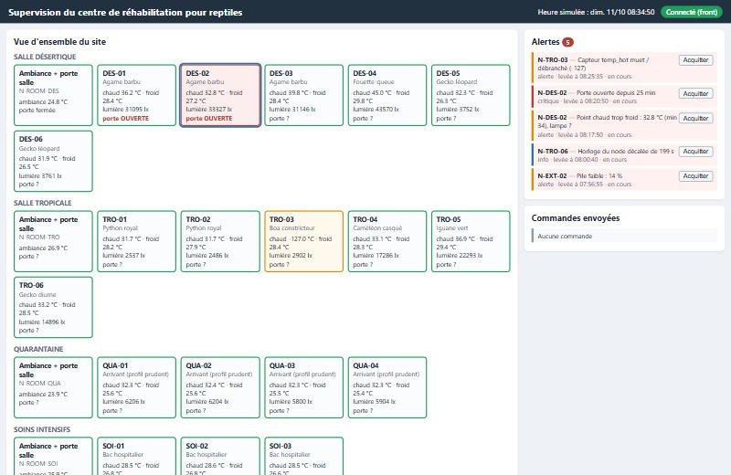
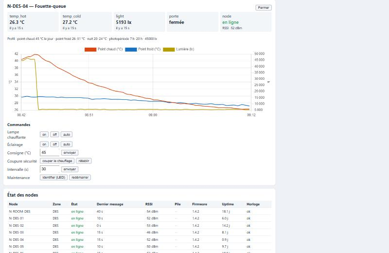
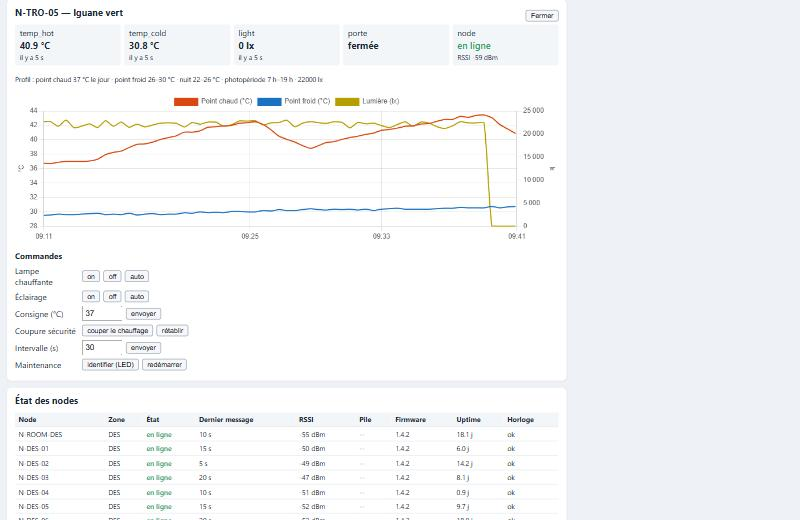
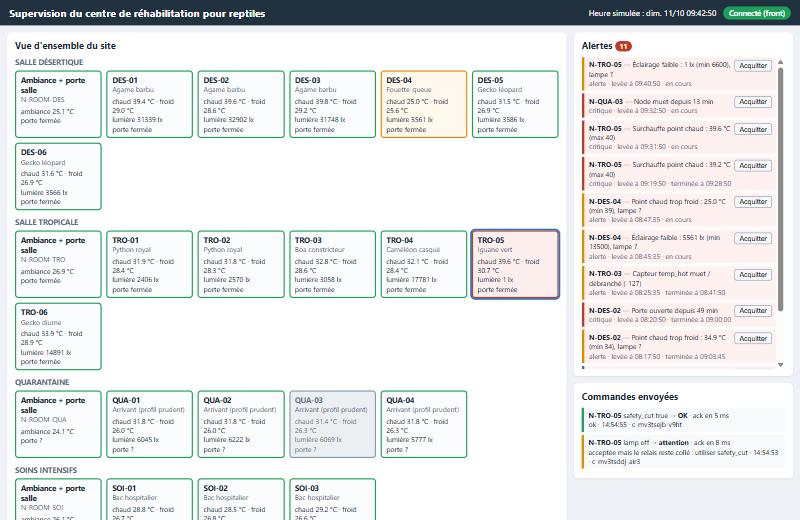
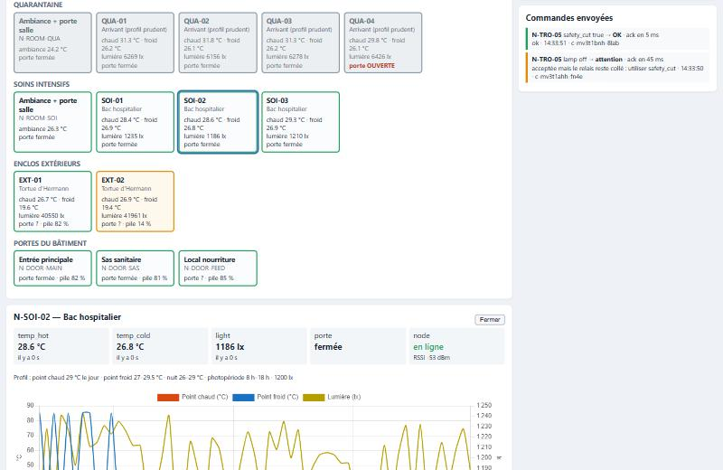
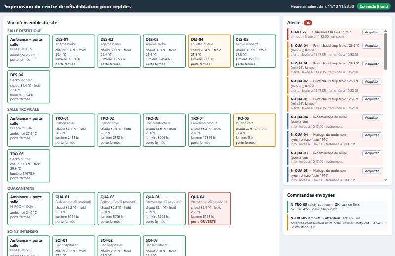
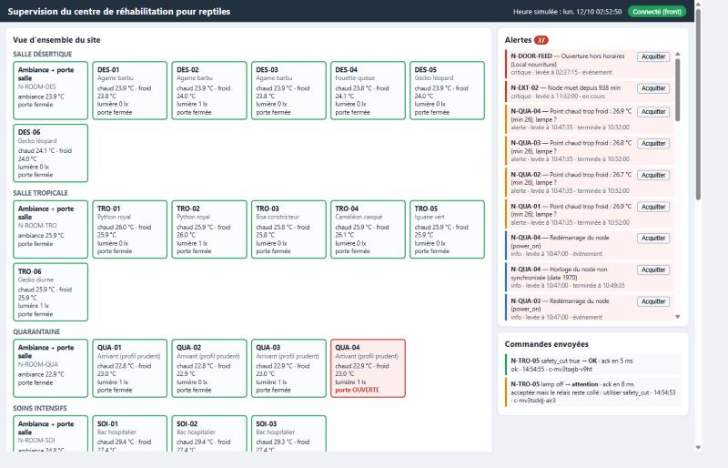

# Partie F : validation sur le scénario `incidents`

## Protocole de test

- Lancement : `docker compose down -v` puis `docker compose up -d` (broker vide, simulateur en scénario `incidents`, vitesse 60 : 1 s réelle = 1 min simulée).
- Début de la simulation : 07:45:00 (heure simulée). Front connecté à 07:59:50, avant le premier incident.
- Les heures ci-dessous sont des heures **simulées** (`rxTs`, horloge de la passerelle). Le délai de détection est l'écart entre le début de l'incident (connu grâce à `scenarios.js`) et l'heure de levée de l'alerte.
- Les captures sont dans `docs/captures/`. La capture 05 vient d'une première exécution identique (même graine, mêmes heures d'alerte) : elle a été ratée lors de l'exécution finale.

## Incidents observés

| # | Incident (heure simulée) | Alerte levée | Heure de l'alerte | Délai | Capture |
|---|---|---|---|---|---|
| 1 | Porte DES-02 mal refermée (08:10 → 09:00) | porte affichée « OUVERTE » sur la vue d'ensemble | 08:10 | < 1 s réelle | 01 |
| | | « Point chaud trop froid » (l'air de la salle entre) | 08:17:50 | 7 min 50 | 01 |
| | | « Porte ouverte depuis 10 min » (critique) | 08:20:50 | 10 min 50 (seuil choisi : 10 min) | 01 |
| 2 | Sonde chaude TRO-03 débranchée (08:25 → 08:37) | « Capteur temp_hot muet / débranché (-127) » | 08:25:35 | 35 s (mesure suivante) | 01 |
| 3 | Lampe DES-04 en panne (08:45) | « Éclairage faible : 5350 lx (min 13500) » | 08:45:35 | 35 s | 02 |
| | | « Point chaud trop froid : 25,6 °C (min 39) » | 08:47:35 | 2 min 35 | 02 |
| 4 | Thermostat TRO-05 bloqué, lampe toujours allumée (09:15) | « Surchauffe point chaud : 40,x °C (max 40) » (critique) | 09:19:50 | 4 min 50 | 03, 04 |
| | Commande `lamp off` | ack `applied_but_relay_feedback_on` : affichée « relais collé, utiliser safety_cut » | 09:40 | ack en 8 ms | 04 |
| | Commande `safety_cut true` | ack OK, la température redescend (courbe), fin de la surchauffe à 09:43:50 | 09:40 | ack en 5 ms | 03, 04 |
| 5 | N-QUA-03 hors ligne (09:30 → 09:45) | « Node muet » (critique) | 09:32:50 | 2 min 50 | 04 |
| | Retour du node | « Redémarrage du node (watchdog) » + « Horloge non synchronisée (date 1970) » | 09:45:00 | immédiat | |
| 6 | Sonde froide SOI-02 en reset intermittent : 85 °C (09:45 → 10:15) | « Valeur aberrante temp_cold : 85 °C (reset de la sonde) » | 09:45:50 | 50 s | 05 |
| 7 | Coupure de courant salle QUA (10:25 → 10:47) | « Node muet » sur les 5 nodes de la salle | 10:27:50 à 10:28:50 | 2 min 50 à 3 min 50 | 05 |
| | Retour du courant | 5 × « Redémarrage (power_on) », puis « Point chaud trop froid » (les terrariums ont refroidi) | 10:47:00 / 10:47:35 | immédiat | 06 |
| 8 | Horloge N-TRO-06 qui dérive de 4 s/min (dès 07:45) | « Horloge du node décalée de … s » (info) | 08:00:40 | ≈ 15 min (seuil 60 s d'écart) | |
| 9 | Pile EXT-02 à 14 % (dès 07:45) | « Pile faible : 14 % » puis critique à 1 % | 07:56:55 | 1er heartbeat reçu | 01 |
| | Décharge rapide (11:05), extinction silencieuse vers 11:17 | « Node muet » (critique) | 11:32:00 | ≈ 15 min après l'extinction | 06 |
| 10 | Ouverture du local nourriture à 02:37:12 (nuit), 95 s | « Ouverture hors horaires (Local nourriture) » (critique) | 02:37:15 | 3 s simulées (< 1 s réelle) | 07 |

Remarques :

- Le délai des alertes de seuil vient surtout de la période de mesure (30 s) et de la confirmation sur 2 mesures. Celui des alertes « node muet » vient du délai choisi (3 min pour un node secteur, 16 min pour un node sur pile qui mesure toutes les 5 min).
- Sur TRO-05, la surchauffe s'est terminée à 09:28:50 puis relevée à 09:31:50 : pendant la tournée des soigneurs, la porte du terrarium a été ouverte et la température est passée sous le seuil (hystérésis de 1 °C). Ce n'est pas un faux positif.
- Après `safety_cut`, le front lève « Éclairage faible » et « Point chaud trop froid » sur TRO-05 : c'est la conséquence normale de la coupure (lampe et éclairage coupés). L'opérateur acquitte ces alertes.

## Captures

Dans l'ordre : 01 porte DES-02 et sonde TRO-03 (08:40) · 02 courbes DES-04, lampe en panne (09:11) · 03 courbes TRO-05, surchauffe puis `safety_cut` (09:33) · 04 vue d'ensemble, QUA-03 muet, commandes et acks (09:37) · 05 coupure QUA, pics à 85 °C sur SOI-02 (10:38) · 06 EXT-02 muet, redémarrages QUA (11:40) · 07 ouverture nocturne du local nourriture (02:37).

      

## Ce que le système n'a pas détecté (ou mal)

1. **Fermeture de la porte QUA-04 perdue pendant la coupure de courant.** La porte a été ouverte pendant la tournée, juste avant la coupure, et refermée pendant que le node était éteint. Le simulateur (comme un vrai node sans alimentation) n'émet rien, et au redémarrage le node ne republie pas l'état de sa porte. Le front garde donc « porte ouverte » et lève une alerte « Porte ouverte depuis … » à tort. C'est un faux positif, du bon côté (quelqu'un va vérifier). Correction côté firmware : publier l'état de la porte (retenu) à chaque démarrage.
2. **Tout ce qui se passe pendant qu'un node est éteint.** Pendant la coupure QUA (22 min), on ne voit pas la baisse de température : on sait seulement que les nodes sont muets. Le refroidissement n'est visible qu'au retour du courant. Correction : une sonde d'ambiance sur pile, ou un onduleur pour les nodes de la quarantaine (température stable exigée).
3. **La cause exacte.** Le système voit une porte ouverte, mais ne sait pas qu'elle est bloquée ; il voit une surchauffe, mais seul l'ack de `lamp off` révèle le relais collé. Le diagnostic reste humain.
4. **L'instant où EXT-02 s'éteint.** Un node sur pile qui meurt ne prévient pas, et sa connexion (via la passerelle) ne tombe pas : pas de Last Will. On le voit seulement par son silence, environ 15 min après.
5. **Les alertes ne sont calculées que si un navigateur est ouvert.** L'énoncé impose un front sans backend : si aucun front n'est connecté, personne n'est alerté. Les messages QoS 1 (portes, status, acks) sont gardés par le broker pour la session persistante du front et rejoués à la reconnexion, mais les mesures (QoS 0) ne le sont pas. En production, il faudrait un service d'alerte côté serveur (SMS / e-mail).
6. **Les courbes ne sont pas conservées.** Elles vivent dans la mémoire du navigateur ; un rechargement de page repart de zéro (pas de base de données, conformément à l'énoncé).
